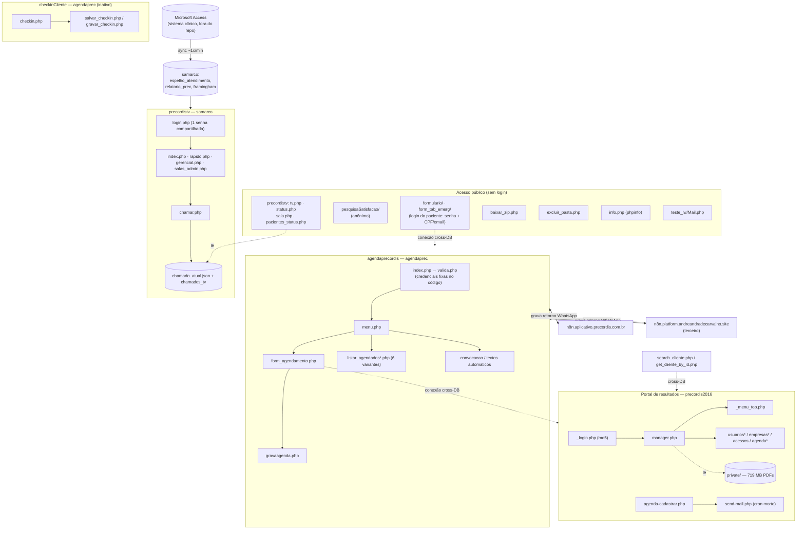

# 02 — Mapa de dependências entre subsistemas e atores

> Fonte: código + confirmação em produção. [C]/[I] como em [01](01-inventario.md).

## 2.1 Mapa de dependências

## 2.2 O que é e o que não é compartilhado

**Bancos compartilhados**
- `precordis2016`: raiz, `checkupNovo`, `formulario`, `formulario_novo`, `form_tab_emerg`, `pesquisaSatisfacao` (escrevem em `usuario`/`info_usuario`/`saude_usuario`/`permissao`). [C]
- `agendaprec`: `agendaprecordis` e `checkinCliente`. [C]
- `samarco`: só `precordistv`. [C]

**Sessão/login — três universos independentes, nenhum integrado** [C]:
| Subsistema | Variável de sessão | Fonte da credencial |
|---|---|---|
| raiz / portal | `$_SESSION['us_id']`, `['administrador']`, `['medico']` | tabela `usuario` (md5) |
| `agendaprecordis` | `$_SESSION['logged_in']` | **2 pares usuário/senha fixos no `valida.php`** + `apoio/precordis` |
| `precordistv` | `$_SESSION['precordis_auth']` | **1 usuário `precordis` + 1 hash fixo** em `auth.php` |
| `checkinCliente` | (nenhuma — `valida.php` não existe na pasta) | formulário aponta para arquivo ausente |
| `formulario` | nenhuma guarda de sessão real; paciente "entra" por senha+CPF | `usuario`/`info_usuario` |

O mesmo médico tem um registro em `usuario` (portal), mas a agenda e a TV não o conhecem — são logins de setor, não de pessoa.

**Chamadas cruzadas entre bancos (sem API, conexão MySQL direta ao outro schema)** [C]:
- `agendaprecordis/form_agendamento.php` e variantes abrem conexão a `precordis2016` para popular o `<select>` de empresa a partir de `empresas`.
- `agendaprecordis/search_cliente.php` e `get_cliente_by_id.php` fazem autocomplete em `precordis2016.usuario JOIN info_usuario`.
- `formulario/index.php:85` abre conexão a `agendaprec` e busca o agendamento do dia do paciente por `NomeCliente LIKE '%nome%'`.

**Tabela escrita por mais de um subsistema**: `agendamento` (agendaprecordis grava; checkinCliente marca `FaltouNoDia`; n8n grava colunas de WhatsApp). `checkincliente` (checkinCliente grava; não há FK com `agendamento`). [C]

**Acoplamento oculto por nome de pessoa** (não por chave): o vínculo paciente ↔ agendamento ↔ exame clínico é feito por **string de nome**, nunca por id — detalhado em [06](06-bancos-legados-dicionario-er.md) e [07](07-inconsistencias-modelagem.md).

## 2.3 Atores / perfis por subsistema

| Ator | Onde atua | Como se autentica | Observação |
|---|---|---|---|
| **Paciente** | portal (vê/baixa seus laudos), `formulario` (anamnese), `pesquisaSatisfacao` | login = senha numérica de 5 dígitos (md5) + CPF/e-mail; pesquisa é anônima | 9.820 pacientes; senha é na prática um "código" de 5 dígitos [C] |
| **Médico / laudador** | portal (`manager.php`, `manager-search.php` — busca pacientes da própria empresa) | `usuario.medico = -1` | 382 médicos; 92 logaram nos últimos 12 meses [C] |
| **Admin Precordis** | portal completo (usuários, empresas, agenda de e-mails, log) | `usuario.administrador = -1` | 14 contas; 7 ativas [C] |
| **Recepção / agendamento** | `agendaprecordis` | 2 e-mails + senha fixos | login de setor [C] |
| **Apoio** | `agendaprecordis` (listagens de impressão) | `apoio/precordis` fixo | [C] |
| **Recepção/sala (TV)** | `precordistv` | 1 login `precordis` compartilhado; sala libera com PIN de 4 dígitos | [C] |
| **Profissional na sala** | `precordistv/sala.php` pelo celular | token na URL `?sala=KEY` + PIN opcional | público, sem login [C] |
| **TV da sala de espera** | `precordistv/tv.php` | nenhuma (público) | [C] |
| **Empresa cliente (PJ/convênio)** | — | **não tem acesso próprio** hoje | `empresas` é só agrupador de pasta de laudo [C] |
| **Sincronizador Access** | grava em `samarco` | credencial `samarco` | robô [C] |
| **n8n** | grava em `agendamento` | credencial `agendaprec` + webhook sem token | robô de terceiro [C] |
