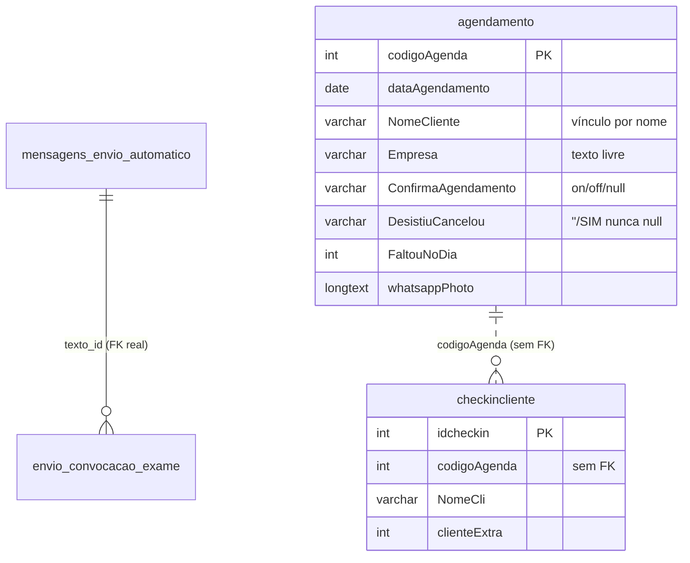
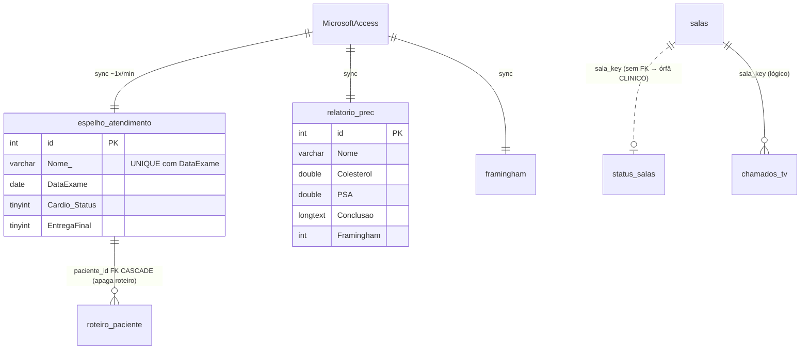

# 06 — Bancos legados: dicionário de dados e diagramas ER (estado atual)

> Schema lido dos dumps e **confirmado** com `information_schema` de produção (31/10/2026). Engine InnoDB em todas; charset predominante `latin1` em `precordis2016`/parte de `agendaprec`, `utf8mb4` em `samarco` e nas tabelas novas. Só **2 FKs declaradas** nos três bancos. [C]

## 6.1 `precordis2016` (portal + cadastro + anamnese)

| Tabela | Colunas-chave | PK | Charset | Linhas | Papel |
|---|---|---|---|---|---|
| `usuario` | `PKId`, `nome`, `login`, `email`, `senha` (claro), `password` (md5), `administrador`(-1/0), `medico`(-1/0), `em_id`, `lastact`, `DataCadastro` | `PKId` | utf8 | 10.216 | Pessoas (paciente/médico/admin). Índices só em `nome`/`email`; **sem `UNIQUE` em `login`** |
| `info_usuario` | `id`, `id_usuario`, `cpf`, `dt_nascimento`(varchar!), `sexo`, `empresa`(varchar), `matricula`, `termos_aceita*`, `primeiro_exame` | **PK composta `(id,id_usuario)`** | latin1 | 10.015 | Dados cadastrais 1:1 do paciente |
| `saude_usuario` | `id`, `id_usuario`, ~40 colunas de anamnese (varchar), `data`(varchar) | **PK composta `(id,id_usuario)`** | latin1 | 6.780 | Anamnese (dado sensível) |
| `empresas` | `em_id`, `em_nome`, `em_parent`, `em_created` | `em_id` | latin1 | 110 | Empresa/convênio hierárquico; 3 índices redundantes em `em_nome` |
| `permissao` | `PKId`, `FKId_Usuario`, `pasta`(caminho Windows), `subpasta` | `PKId` | utf8 | 10.539 | Pasta de laudo por usuário |
| `permissao_diretorioComposto` | `fkPrincipal`, `fkId_Usuario`, `pastaVisivel`, `subpasta` | `fkPrincipal` | latin1 | 9 | Unidades extras visíveis (quase sem uso) |
| `mensagens` | `ms_id`, `PKId`, `ms_subject`, `ms_text`, `ms_date`, `ms_sent`, `ms_status` | `ms_id` | latin1 | 27.937 | Fila de e-mail (morta) |
| `watchdog` | `wa_id`, `wa_event`, `us_id`, `wa_timestamp`, `wa_ip`(varchar 16!) | `wa_id` | latin1 | 119.613 | Log de login |
| `pesquisa_NPS` | `idPesquisa`, `DataPesquisa`, `NotaPesquisa` | `idPesquisa` | latin1 | 1.914 | NPS 0–10 anônimo |
| `pesquisa_Satisfacao` | `idPesquisaSatisfacao`, `idPesquisa`, 4 notas, `Observacoes`, `cliente` | `idPesquisaSatisfacao` | latin1 | 2.014 | Satisfação (vínculo NPS bugado) |
| `lembrete_resultado_exames` | `id`, `nome`, `celular`, `mensagem`, `situacao`, `motivo` | `id` | latin1 | 13 | Log de lembrete WhatsApp (teste) |
| `taxonomy_term_data` | `tid`, `vid`, `name`, ... | `tid` | utf8 | 110 | **Resíduo do Drupal**; 23 nomes coincidem com `empresas` |
| `Tablet_DadosFinais`, `Tablet_Info_Saude` | — | — | — | **Views** que juntam usuario+info+saude (uso em tablet) |

```mermaid
erDiagram
  usuario ||--o| info_usuario : "PKId = id_usuario (lógico)"
  usuario ||--o| saude_usuario : "PKId = id_usuario (lógico)"
  usuario ||--o{ permissao : "PKId = FKId_Usuario (lógico)"
  usuario ||--o{ permissao_diretorioComposto : "lógico"
  usuario ||--o{ mensagens : "PKId = PKId (lógico)"
  usuario ||--o{ watchdog : "PKId = us_id (lógico)"
  empresas ||--o{ usuario : "em_id (lógico)"
  empresas ||--o{ empresas : "em_parent (auto)"
  pesquisa_NPS ||--o| pesquisa_Satisfacao : "idPesquisa (bugado)"
  usuario {
    int PKId PK
    varchar nome
    varchar login "sem UNIQUE"
    varchar senha "texto plano"
    varchar password "md5"
    int administrador "-1/0"
    int medico "-1/0"
    int em_id
  }
  info_usuario {
    int id PK
    int id_usuario PK
    varchar cpf
    varchar dt_nascimento "formatos mistos"
    varchar empresa
    tinyint termos_aceita
  }
  empresas {
    int em_id PK
    varchar em_nome
    int em_parent
  }
```

## 6.2 `agendaprec` (agendamento + campanhas)

| Tabela | Colunas-chave | PK | Linhas | Papel |
|---|---|---|---|---|
| `agendamento` | `codigoAgenda`, `dataAgendamento`(date), `NomeCliente`, `sexo`, `Empresa`(texto), `Email`, `Especialidade`, `ConfirmaAgendamento`, `DesistiuCancelou`, `FaltouNoDia`, `datanasc`(varchar), + ~15 colunas de WhatsApp (`enviouMensagem*`, `isWhatsappNumber`, `whatsappPhoto` longtext, `notificouNaoConfirmou*`) | `codigoAgenda` | 6.894 | Pré-agenda do dia. **Sem `patient_id`** |
| `checkincliente` | `idcheckin`, `codigoAgenda`, `NomeCli`, 19 colunas de exame (varchar 10), `clienteExtra`, `dataPreenchimento` | `idcheckin` | 1.327 | Progresso por exame. Sem FK com `agendamento` |
| `lembra_procedimento` | `id`, `emails`, `texto`(longtext), `nome`, `enviou`, `retorno_envio` | `id` | 6.604 | Campanha WhatsApp (31,6 MB) |
| `mensagem_fim_de_ano` | `id`, `nome`, `numero`, `wuid_whatsapp`, `enviou`, `falhou`, `picture_whatsapp` | `id` | 2.090 | Campanha de fim de ano |
| `envio_convocacao_exame` | `id`, `nome`, `data`, `email`, `texto_id`→, `enviou`, `leu`, `liberado`, `sexo`(enum) | `id` | 27 | Convocação; **única FK real** → `mensagens_envio_automatico` |
| `mensagens_envio_automatico` | `id`, `titulo`, `texto`, `anexo_1/2`, `destino`(enum), `tipo`, `empresa_id`, `status`(enum) | `id` | 6 | Modelos de mensagem |
| `atendimentos` | `id`, `numero_celular`, `opcao_selecionada` | `id` | 11 | Estado de bot WhatsApp |
| `configuracao_nao_confirmado` | `id`, `ativo`, `mensagem` | `id` | 1 | Flag da campanha de não-confirmados (ativa) |
| `entrada` | `idacesso`, `usuario`, `senh`, `perfil` | `idacesso` | 2 | Login antigo (sem uso no código atual) |

## 6.3 `samarco` (TV + resultado clínico, espelho do Access)

| Tabela | Colunas-chave | PK | Linhas | Papel |
|---|---|---|---|---|
| `espelho_atendimento` | `id`, `CodigoAuxPrincipal`(sempre 0), `Nome_`, `DataExame`, ~20 pares `<Exame>`/`<Exame>_Status` (tinyint), `EntregaFinal`, `sincronizado_em` | `id`; **`UNIQUE(Nome_,DataExame)`** | 917 | Espelho do Access; pacientes do dia na TV |
| `relatorio_prec` | `id`, `Nome`, `Idade`, 63 colunas clínicas (`Colesterol`, `HDL_Col`, `LDL_Col`, `Triglicerides`, `Glicose`, `PSA`, `TSH`, `PCR`, `Framingham`, pressão, peso, `Conclusao`/`HipoteseDiagnost`/`PontoCritico1-3` longtext), `MATRICULA`, `TipoExame`, `Origem` | `id` | 270 | **Resultado clínico estruturado** (o laudo de verdade) |
| `framingham` | `id`, `registro`, `nome`, `matricula`, `framingham` | `id` | 87 | Escore de risco |
| `log_sync` | `id`, `executado_em`, `registros_sync`, `status`, `mensagem` | `id` | 86.122 | Log do sincronizador Access→MySQL |
| `salas` | `id`, `sala_key`, `sala_nome`, `ordem`, `ativo`, `pin`(varchar 4, texto plano) | `id`; `UNIQUE(sala_key)` | 18 | Salas da TV |
| `status_salas` | `sala_key`, `sala_nome`, `status`(enum livre/ocupada), `paciente_nome`, `atualizado_em` | `sala_key` | 19 | Estado atual da sala (**sem FK → `salas`**, daí a sala fantasma `CLINICO`) |
| `roteiro_paciente` | `id`, `paciente_id`→, `sala_key`, `ordem`, `concluido` | `id`; **FK → `espelho_atendimento.id` ON DELETE CASCADE** | 0 | Roteiro (zerado pelo bug B2) |
| `chamados_tv` | `id`, `paciente_nome`, `sala_nome`, `sala_key`, `chamado_em`, `liberado_em`, `exibido` | `id` | 512 | Histórico de chamadas |

## 6.4 Cruzamento entre bancos — o mesmo paciente em 3 (ou 4) lugares

O mesmo conceito "paciente" existe como:

| Representação | Banco | Chave | Qualidade do vínculo (medido em 31/10/2026) |
|---|---|---|---|
| `usuario` (+`info_usuario`) | precordis2016 | `PKId`; CPF em 61,6% | base cadastral "oficial" |
| `agendamento.NomeCliente` | agendaprec | **só nome** | casa com a base por nome: 56,2% exato, +13,9% por primeiro+último nome; **29,9% (2.063) sem casamento**; 239 ambíguos |
| `espelho_atendimento.Nome_` / `relatorio_prec.Nome` | samarco | **só nome** | espelho casa 99,9% com a base cadastral; mas só 55,9% com o agendamento |
| registro no **Microsoft Access** | externo | `CodigoAuxPrincipal`? (sempre 0 no espelho) | chave real desconhecida |

**Conclusão**: a única "chave" que atravessa os sistemas é o **nome da pessoa** — frágil, não-única, com acentuação inconsistente. CPF existe só na base cadastral e falta em 38%. Isto domina a estratégia de migração ([13](../fluxos/13-plano-migracao-dados.md)) e a modelagem nova ([12](../fluxos/12-novo-schema-unificado.md)).
