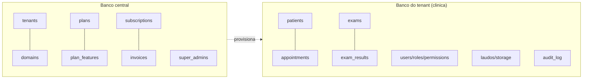

# 09 — Estratégia multi-tenant

## 9.1 As três opções, aplicadas a este caso

Contexto que pesa na decisão: **dado de saúde (LGPD art. 11)**, clínicas pequenas/médias, necessidade de **backup/restore e exclusão por cliente**, poucos tenants no início, e relatórios cross-tenant só para o super-admin da plataforma.

| Critério | A) Banco único + `tenant_id` | B) Banco por tenant | C) Híbrido (central + banco por tenant) |
|---|---|---|---|
| Isolamento LGPD | lógico (depende de scope correto em 100% das queries) | **físico** (forte) | físico |
| Risco de vazamento cross-tenant | maior (um `where` esquecido vaza) | baixo | baixo |
| Backup/restore por clínica | difícil (extrair linhas) | **trivial** (dump do banco) | trivial |
| Exclusão de um cliente (LGPD) | difícil | **trivial** (drop) | trivial |
| Custo/infra | menor | maior (N bancos) | médio |
| Relatório cross-tenant | fácil | difícil | fácil (dados agregados no central) |
| Migração de 1 clínica entre servidores | difícil | fácil | fácil |
| Complexidade de código | menor | média (gestão de conexões) | média |
| Onboarding self-service | instantâneo | criar banco (segundos) | criar banco |

## 9.2 Recomendação: C) Híbrido — **banco central + um banco por tenant**

**Justificativa.** Para dado de saúde, o isolamento **físico** por tenant é o que melhor sustenta LGPD, backup/restore e exclusão por clínica, e elimina a classe inteira de bug "esqueci o `tenant_id`" — que é exatamente o tipo de falha que derrubou o legado (autorização no cliente, filtro que não filtra). O banco **central** guarda o que é da plataforma (tenants, planos, assinaturas, super-admin, catálogo global opcional); cada **tenant** tem seu banco com pacientes, agenda, laudos. Clientes enterprise que exijam servidor dedicado entram no mesmo modelo, só que com o banco em outra instância — sem mudar código.

Isto é mais simples de operar do que parece no volume real: a Precordis tem ~10 mil pacientes e ~900 atendimentos espelhados — um banco por clínica é leve.

## 9.3 Implementação

- **Pacote:** `stancl/tenancy` (Tenancy for Laravel) — a linha 3.x estável já declara suporte a `illuminate/support ^13.0` (verificado em 31/10/2026, v3.10.1); a v4 está em documentação/preview e **deve ser reavaliada** quando sair estável. Sempre **atrás de contratos próprios** (`TenantResolver`, `TenantContext`) para não acoplar o domínio ao pacote — se a v4 ou outro pacote for adotado depois, troca-se a implementação, não o domínio.
- **Identificação do tenant:**
  - **Subdomínio** `clinica.suaplataforma.com.br` (padrão) — já funciona com `InitializeTenancyByDomain`.
  - **Domínio próprio** para enterprise (`agenda.precordis.com.br`).
  - **Header** `X-Tenant` para a API.
  - **Token de dispositivo** para TV/totem (sem subdomínio de pessoa).
- **Rotas**: por padrão tenant; rotas centrais (login do super-admin, site de marketing, webhooks de billing) marcadas como `central`.
- **Isolamento em todas as camadas** (não só query): conexão de banco, **cache** (prefixo por tenant), **filas/jobs** (tenant serializado no job, re-inicializado no handler), **storage de arquivos** (disco/prefixo por tenant para os laudos), **sessões**, **logs**, **broadcasting** (canais por tenant), **e-mail** (remetente/assinatura por tenant), **busca** (índice por tenant). O `stancl/tenancy` cobre a maioria via *bootstrappers*; os demais entram atrás dos nossos contratos.
- **Dados centrais** vs **do tenant**:

- **Multiunidade dentro do tenant**: uma clínica com filiais tem **uma** base (um tenant) e uma tabela `units`; agenda, sala e usuário referenciam `unit_id`. (No legado, `empresas` é cliente, não unidade da clínica — a unidade é conceito novo.)

## 9.4 Testes que provam o isolamento (obrigatórios)

- Teste que cria 2 tenants, popula paciente em cada e **falha** se um request autenticado no tenant A retornar qualquer linha do tenant B (query, cache, storage, job, broadcast).
- Teste de arquitetura (Pest Arch) proibindo query a modelos de tenant sem contexto de tenant inicializado.
- Teste de storage: laudo do tenant A nunca resolve num path do tenant B.
- Teste de fila: job despachado no tenant A roda com a conexão do tenant A.

Estes testes são o contrato que impede a repetição do vazamento do legado.
