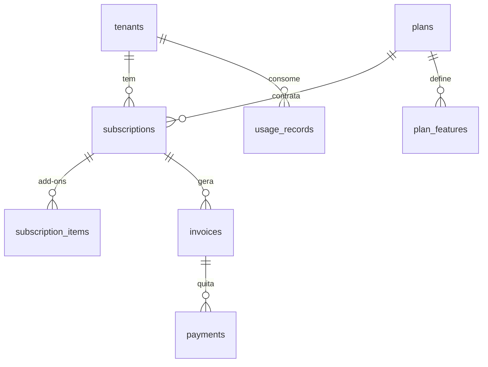

# 10 — Assinatura e billing

## 10.1 Modelo de planos

Cobrança **da clínica** (B2B), não do paciente. Dimensões possíveis:

| Dimensão | Opções |
|---|---|
| Base | por **unidade** da clínica (recomendado p/ começar) ou por volume de exames/agendamentos/mês |
| Add-ons | Portal da Empresa, Assinatura digital ICP-Brasil, BI avançado, WhatsApp, banco dedicado (enterprise) |
| Faixas | Starter (1 unidade, N exames/mês) → Pro → Enterprise (dedicado) |
| Ciclo | mensal / anual (desconto) |
| Trial | 14 dias |
| Carência / inadimplência | bloqueio progressivo: aviso → somente leitura → suspensão |
| Pró-rata | upgrade/downgrade no meio do ciclo |
| Cupons | sim |

Limites por plano (ex.: nº de unidades, usuários, exames/mês, storage de laudos) viram **feature flags** aplicadas por **middleware/policy** — não espalhadas em `if`.

## 10.2 Gateway

| Candidato | Prós | Contras |
|---|---|---|
| **Asaas** (recomendado) | PIX, boleto e cartão recorrente nativos; **assinaturas** (recorrência) e **emissão de NFS-e** da própria assinatura na API; webhooks; mercado BR | menos "global" que Stripe |
| Pagar.me / Iugu | recorrência BR madura | NFS-e varia |
| Mercado Pago | alcance | recorrência menos flexível p/ B2B |
| Laravel Cashier (Stripe/Paddle) | integração Laravel 1ª classe | cartão internacional; PIX/boleto limitados; menos aderente ao B2B BR |

**Recomendação:** **Asaas** para o mercado brasileiro — cobre PIX + boleto + cartão recorrente e **emite NFS-e da assinatura** (confirmado na documentação do Asaas em 31/10/2026), o que resolve a nota fiscal da mensalidade sem integração extra. Decisão final cabe ao negócio (perguntas-em-aberto #18).

**Independência de provedor (princípios O e D):** todo o billing depende de uma interface própria:

```php
interface BillingGatewayContract {
    public function createCustomer(Tenant $t): string;
    public function createSubscription(Tenant $t, Plan $p, PaymentMethod $m): SubscriptionResult;
    public function changePlan(Subscription $s, Plan $new): SubscriptionResult; // pró-rata
    public function cancel(Subscription $s): void;
    public function handleWebhook(array $payload, string $signature): WebhookEvent;
}
```

Implementações `AsaasGateway`, `StripeGateway` (via Cashier) etc. são intercambiáveis; o domínio nunca importa o SDK do provedor.

## 10.3 Webhooks, conciliação, NFS-e

- **Webhooks idempotentes**: cada evento do gateway tem id; grava-se em `webhook_events` e ignora repetição (o Asaas documenta idempotência por `externalReference` + id do evento).
- **Conciliação**: `payments` reconcilia com os eventos; divergência gera alerta ao super-admin.
- **NFS-e da assinatura**: emitida pelo gateway (Asaas) ou por integração municipal, conforme o negócio.
- **Bloqueio por inadimplência**: estado da assinatura (`active → past_due → read_only → suspended`) aplicado por middleware; nunca apaga dados (LGPD/guarda de prontuário).

## 10.4 Tabelas (banco central)

`plans`, `plan_features`, `subscriptions`, `subscription_items`, `invoices`, `payments`, `usage_records` (p/ cobrança por volume), `coupons`, `webhook_events`. Ajustar nomes aos campos do gateway escolhido.


