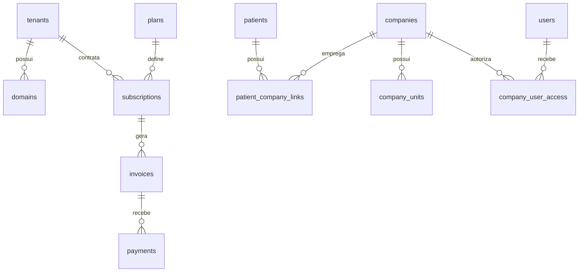
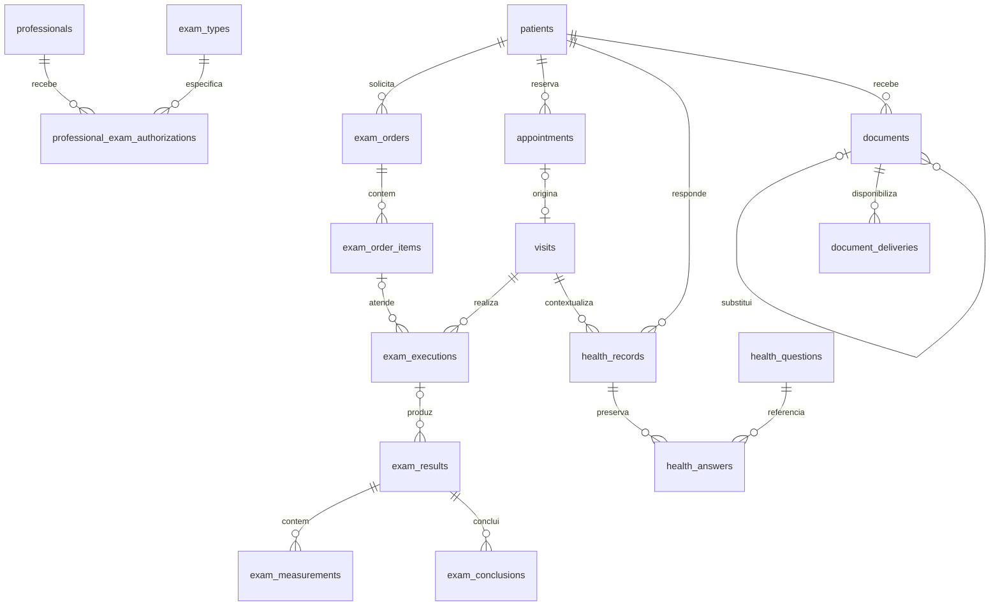
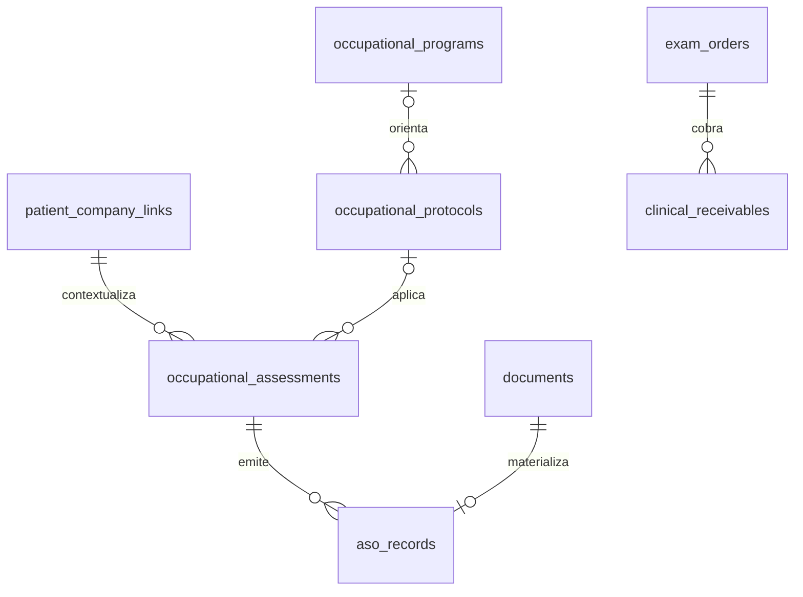

# 12 — Modelo de dados e correspondência executável

[Confirmado] Fonte executável de referência: [schema.sql](../schema/schema.sql). A aplicação ainda deve converter o contrato em migrations e testes conforme [20](20-plano-desenvolvimento.md). [21](21-schema-e-reaproveitamento.md) descreve aplicação e inventário; [CHANGELOG](../schema/CHANGELOG.md) registra alterações. Diagramas abaixo representam o DDL corrente, sem inventar tabelas substitutas.

## 12.1 Princípios

- [Inferido] Banco único conforme [09](09-estrategia-multi-tenant.md), InnoDB/utf8mb4, versão definida em [14](14-arquitetura-laravel.md). Propriedade global, direta, indireta e exceções têm contratos distintos.
- [Inferido] BIGINT interno; ULID público quando houver recurso exposto. Autorização independe de opacidade do id. Valores monetários DECIMAL, datas tipadas e timestamps UTC. Enums de aplicação têm valores documentados em [22](22-atendimento-clinico.md)/[23](23-saude-ocupacional.md).
- [Inferido] Soft delete onde houver ciclo de cadastro; não exigir deleted_at em todo evento imutável. Autoria e auditoria são obrigações por caso de uso, não presença presumida de created_by em toda tabela.
- [Inferido] Criptografia, snapshots e guarda seguem [24](24-seguranca-retencao-operacao.md). Charset uniforme não repara dados já corrompidos; ETL trata encoding por coluna/linha.

## 12.2 Plataforma e cadastros

[Confirmado] Plataforma: platform_users, tenants, domains, plans, plan_features, subscriptions, subscription_items, invoices, payments, usage_records, coupons, webhook_events, audit_log_central e permissions. ACL da clínica: roles e pivôs Spatie. A classificação detalhada fica em 09; não inferir propriedade apenas pela presença de tenant_id.

## 12.3 Atendimento e resultado

[Confirmado] As entidades correspondem ao fluxo [22](22-atendimento-clinico.md); os estados e invariantes ficam nessa fonte.

## 12.4 Ocupacional e módulos auxiliares

[Confirmado] Salas/chamada: rooms, room_states, tv_calls; comunicação: message_templates, campaigns, messages; pesquisa: surveys; preferências: settings. Questionários versionados e medições preservam snapshots. Contrato de migração: [13](13-plano-migracao-dados.md); rastreabilidade usa legacy_references, migration_runs, migration_issues e patient_match_candidates.

[Inferido] FKs validam existência e tenant; relações redundantes ainda exigem igualdade de paciente, empregador, unidade e item na Action. JSON versionado guarda contexto variável, sem autorizar conteúdo arbitrário: validar forma, versão e campos obrigatórios no servidor.

[Confirmado] O incremento de [check-in](../outros/check-in-atendimento.md) acrescenta unique tenant/appointment_id em visits: uma reserva não nula origina no máximo um atendimento, alinhado ao diagrama acima. Vínculo ao pedido não é único: exames/dias distintos podem usar reservas diferentes; nullable permanece para históricos/encaixes futuros.
