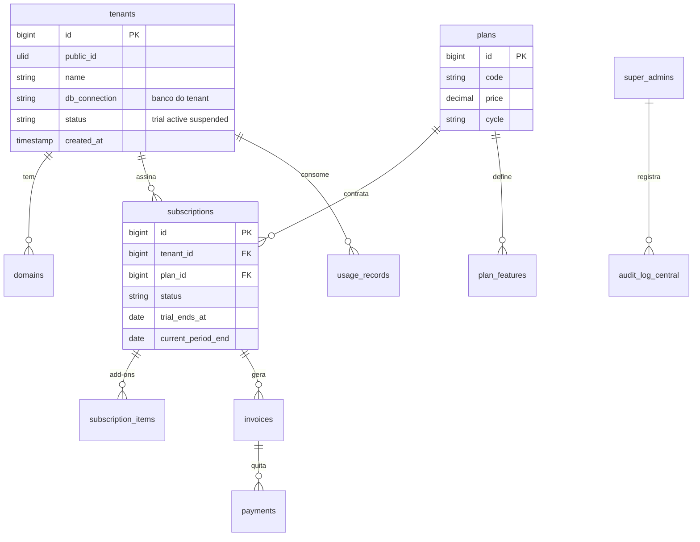
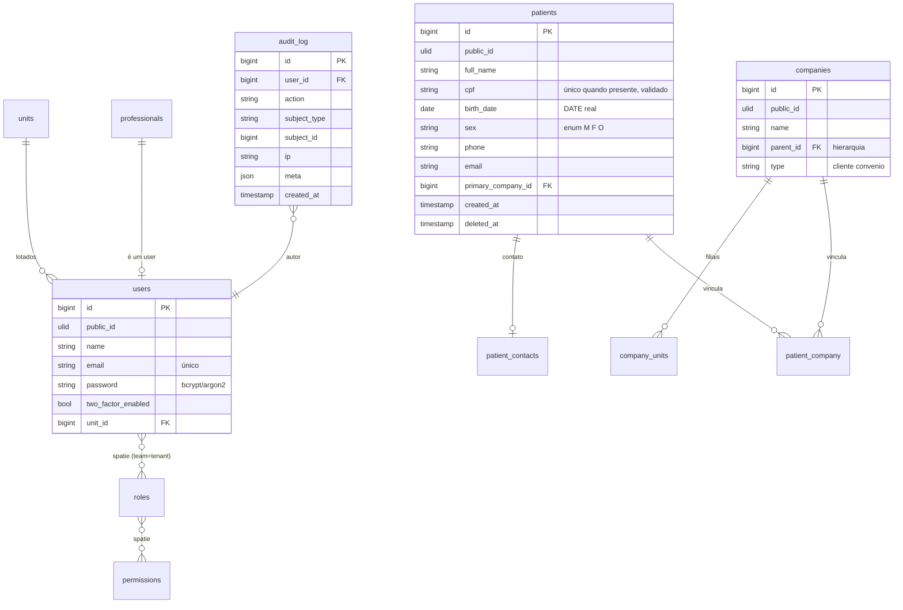
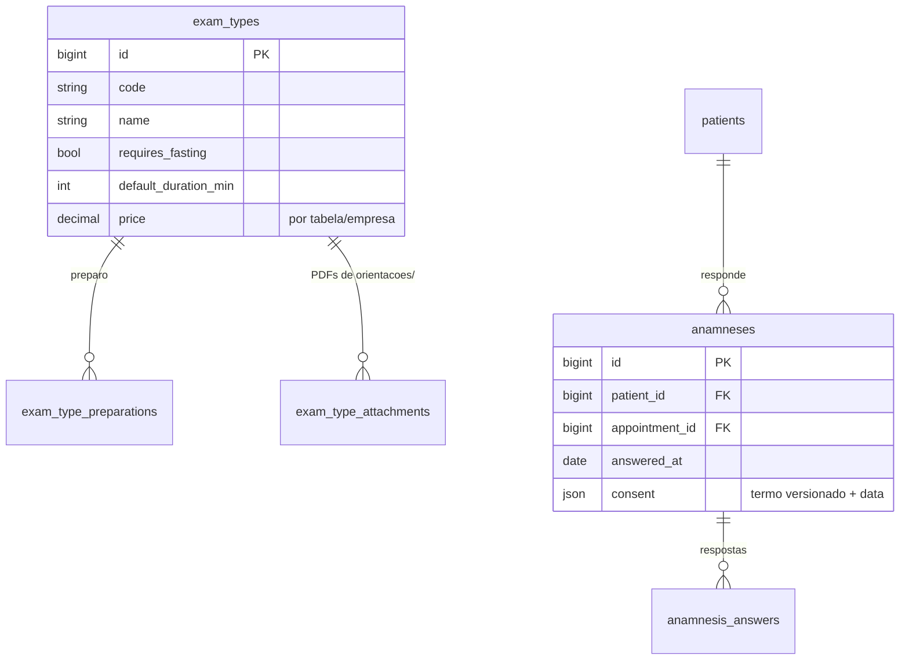
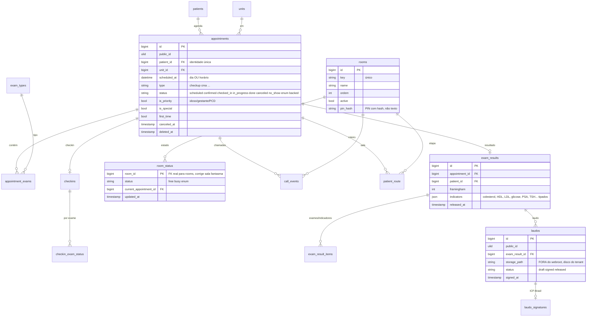
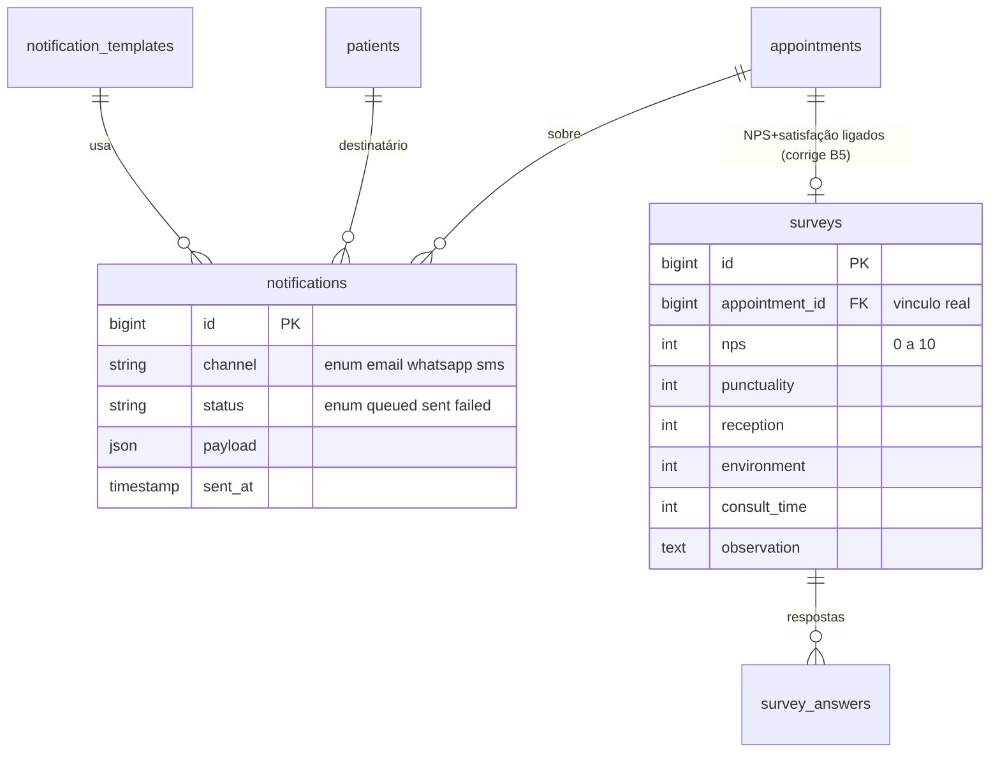

# 12 — Novo schema de banco de dados unificado

## 12.1 Princípios

- [Confirmado] **MySQL ou MariaDB**, nas versões estáveis de destino da [matriz única em 14 §14.1](14-arquitetura-laravel.md#141-stack--fonte-única-de-versões), **InnoDB**, **`utf8mb4`** e FKs reais. O DDL existente usa `utf8mb4_0900_ai_ci`; suporte e semântica da collation devem ser homologados no motor escolhido. A atualização documental das versões não valida nem modifica as tabelas.
- **Soft delete** (`deleted_at`) e **auditoria** (`created_at`, `updated_at`, `created_by`, `updated_by`) em todas as tabelas de domínio.
- **Dinheiro** em `DECIMAL(12,2)` (ou inteiro em centavos) — nunca `float`. Datas em `DATE`/`DATETIME`, nunca `varchar`.
- **Status/tipo** como **enum PHP *backed*** + coluna `varchar`/`enum` correspondente.
- **IDs públicos não sequenciais**: `ULID` em colunas `public_id` usadas em URL e API; `BIGINT` interno como PK.
- **Isolamento por banco de tenant** (estratégia C, [09](09-estrategia-multi-tenant.md)): as tabelas de tenant **não** precisam de `tenant_id` (o banco já é do tenant). Mantém-se `unit_id` para multiunidade. *(Se no futuro algum módulo voltar a banco único, os índices compostos devem iniciar por `tenant_id`.)*
- Charset/collation uniformes eliminam o mojibake do legado.

## 12.2 Banco central (plataforma)

Tabelas: `tenants`, `domains`, `plans`, `plan_features`, `subscriptions`, `subscription_items`, `invoices`, `payments`, `usage_records`, `coupons`, `webhook_events`, `super_admins`, `audit_log_central`.

## 12.3 Banco do tenant — módulos

### Cadastros, identidade, auditoria

### Catálogo de exames + anamnese

### Agenda, recepção, chamada (TV), resultados/laudos

### Notificações, pesquisa, billing-uso

## 12.4 Como o novo schema resolve os problemas do legado

| Problema legado (doc 07) | Solução no schema |
|---|---|
| Identidade por nome em 3 bancos | `patients` único; agenda/resultado referenciam `patient_id` (FK) |
| CPF duplicado/ausente | `cpf` único **quando presente** (índice único parcial via lógica/validação), validação de DV; dedupe no ETL |
| Datas em varchar, formatos mistos | colunas `DATE`/`DATETIME`; parser por linha no ETL |
| `Status` lixo / `DesistiuCancelou` nunca null | enum `appointment.status` *backed*, único campo de estado |
| Sala fantasma (sem FK) | `room_status.room_id` **FK real** → `rooms` |
| Roteiro apagado em cascata | `patient_route` ligado a `appointment` (não ao espelho recriado); sem o sync destrutivo |
| NPS ↔ satisfação solto | `surveys.appointment_id` liga tudo |
| Colunas de exame repetidas (19/~20) | `appointment_exams` / `checkin_exam_status` / `exam_result_items` (linhas, não colunas) |
| Resultado clínico só no Access | `exam_results` + `exam_result_items` como entidade 1ª classe |
| Sem soft delete / auditoria | `deleted_at` + `created_by`/`updated_by` + `audit_log` |
| Laudo no webroot, URL adivinhável | `laudos.storage_path` fora do webroot + link assinado |
| Mojibake | `utf8mb4` uniforme + limpeza no ETL |
| PIN de sala em texto | `rooms.pin_hash` |

## 12.5 Observações

- **Índices**: `patients(cpf)`, `patients(full_name, birth_date)`, `appointments(unit_id, scheduled_at, status)`, `room_status(status)`, `laudos(public_id)`, `audit_log(subject_type, subject_id)`.
- **Anamnese** pode ser `json` tipado (respostas) para flexibilidade por tipo de exame, com as perguntas versionadas em `exam_types`.
- O ER acima é por módulo; o diagrama geral e as migrations na ordem estão em [14](14-arquitetura-laravel.md).
- Nomes de tabela em inglês são sugestão (decisão de idioma em [14](14-arquitetura-laravel.md) §14.7 → perguntas-em-aberto #20).
