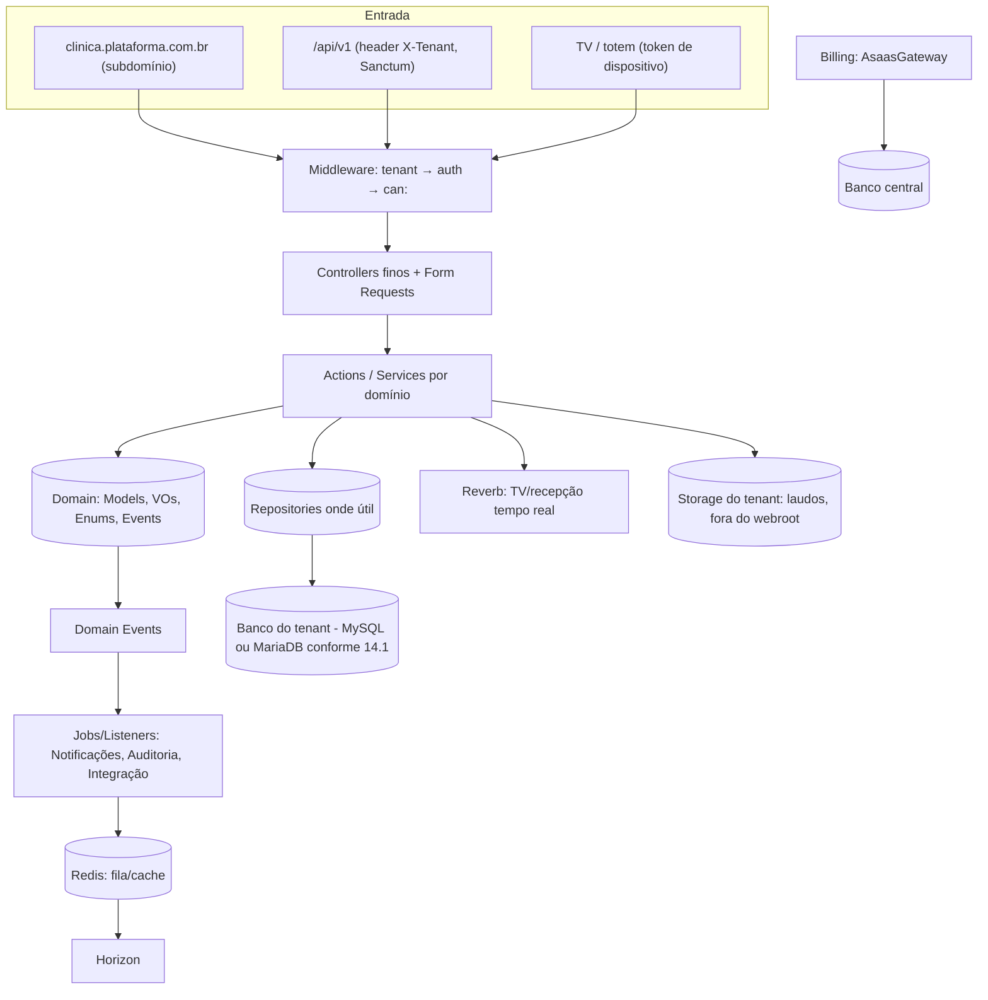

# 14 — Arquitetura Laravel

## 14.1 Stack — fonte única de versões

> [Confirmado] Matriz atualizada em **31/10/2026**, por solicitação do usuário, para usar versões estáveis recentes de PHP, Laravel e MySQL ou MariaDB. Esta seção substitui as escolhas anteriores de PHP 8.4 e MySQL 8.4 como alvo do novo sistema; versões históricas do legado permanecem como evidência.

| Camada | Escolha | Versão de referência / evidência | Observação |
|---|---|---|---|
| Framework | **Laravel 13.x** | [Confirmado] **13.39.0**, publicado em 27/10/2026 | Release estável mais recente consultada; Laravel 13 suporta PHP 8.3–8.5. Fontes: [releases oficiais](https://github.com/laravel/framework/releases/tag/v13.39.0), [política de suporte](https://laravel.com/framework/docs/releases). |
| Linguagem | **PHP 8.5.x** | [Confirmado] **8.5.12**, publicado em 21/10/2026 | Última versão estável consultada; PHP 8.6 está em RC e não integra o alvo. Fontes: [lançamentos](https://www.php.net/index.php), [suporte](https://www.php.net/supported-versions.php). |
| Banco — opção MySQL | **MySQL Community Server 26.10.x** | [Confirmado] **26.10.0**, publicado em 20/10/2026 | Versão GA mais recente consultada, linha Innovation. Fontes: [download GA](https://dev.mysql.com/downloads/mysql/), [release notes](https://dev.mysql.com/doc/relnotes/mysql/26.10/en/), [Innovation e LTS](https://dev.mysql.com/doc/refman/26.10/en/mysql-releases.html). |
| Banco — opção MariaDB | **MariaDB Server 13.0.x** | [Confirmado] **13.0.2**, publicado em 15/09/2026 | Versão Stable mais recente consultada, linha rolling; 13.1 RC e 13.2 Preview não integram o alvo. Fontes: [releases oficiais](https://mariadb.org/mariadb/all-releases/), [anúncio de estabilidade](https://mariadb.org/mariadb-13-0-is-now-stable/). |
| Cache/fila/sessão | **Redis** + **Laravel Horizon** | atual | |
| Tempo real | **Laravel Reverb** | v1.12.0 (22/09/2026) | TV e fila de recepção em tempo real — **substitui o polling** do `precordistv`/`checkin` |
| Multi-tenant | **stancl/tenancy 3.x** atrás de contrato próprio | v3.10.1 declara `illuminate/support ^13.0` | v4 em preview — reavaliar; domínio não acopla ao pacote |
| ACL | **spatie/laravel-permission** (teams=tenant) | v8.x (v8.3.2 em 19/10/2026, suporta ^13) | |
| Auth | **Fortify** + **Sanctum** (+2FA TOTP) | atual | Passport só se necessário |
| Back-office (recepção/agenda/cadastros/admin) | **Filament** | v4 / v5 (v5 de 16/01/2026, Livewire v4; v4 mantém features) | acelera CRUD; escolher v4 (estável, mais plugins) ou v5 |
| Portais paciente/empresa + TV (alto polimento) | **Inertia + React** | Inertia v2 (starter kit oficial) hoje; v3 estável (26/03/2026, exige Laravel 11+/React 19+) a avaliar | design premium (refs. apple/b&o) vive aqui |
| Busca | **Laravel Scout** (se necessário) | atual | autocomplete de paciente |
| Testes | **Pest 4** | pest-plugin-laravel v4.1 suporta L13 | |
| Análise estática | **Larastan/PHPStan 3** (nível máximo viável) | v3 | |
| Estilo/refactor | **Laravel Pint**, **Rector** | atual | |
| Observabilidade (dev) | **Pulse / Telescope** | atual | só em dev |
| PDF do laudo | **dompdf** (já no legado) ou equivalente | dompdf 3.x | geração server-side |

### 14.1.1 Política de atualização e compatibilidade

- [Confirmado] A matriz acima é o registro central das versões de PHP, Laravel e banco. Os demais documentos devem apontar para esta seção, sem manter matrizes concorrentes. Os componentes complementares da tabela são propostas anteriores; esta atualização não certifica suas versões ou compatibilidade.
- [Confirmado] Adotar uma das opções de banco por ambiente de implantação, mantendo **central e tenants no mesmo motor e versão**. Preservar o desenho de banco central + um banco por clínica. O suporte documentado do Laravel a MySQL e MariaDB não comprova que os DDLs e pacotes deste projeto já foram homologados nessas versões. Fonte: [bancos suportados pelo Laravel](https://laravel.com/framework/docs/13.x/database).
- [Confirmado] “Mais recente estável” não significa “LTS”. Para uma decisão explícita de suporte longo, as alternativas LTS consultadas são **MySQL 9.7.4** e **MariaDB 12.3.3**; não são a escolha mais recente das linhas GA/Stable acima. Fontes: [MySQL 9.7](https://dev.mysql.com/doc/relnotes/mysql/9.7/en/), [MariaDB 12.3 LTS](https://mariadb.org/mariadb-server-12-3-lts-released/), [lista de versões MariaDB](https://mariadb.org/mariadb/all-releases/).
- [Confirmado] Antes de instalar ou atualizar, reconfirmar a última versão estável oficial, registrar a data e fixar as versões efetivas em `composer.lock` e nas imagens de infraestrutura. Não usar tags flutuantes `latest` como registro de versão nem adotar Preview, Beta ou RC como padrão.
- [Inferido] Na fundação, validar dependências/extensões em PHP 8.5, migrations/seeds e testes no motor escolhido, registrando a versão exata do servidor. Só anunciar suporte aos dois motores após validar ambos. Repetir a homologação ao trocar de motor ou atualizar sua versão principal.
- [Confirmado] Os DDLs atuais em [central.sql](../schema/central.sql) e [tenant.sql](../schema/tenant.sql) usam `utf8mb4_0900_ai_ci`; isso é uma característica do SQL existente, não prova de equivalência de collations entre motores. Consultar a [referência MariaDB](https://mariadb.com/docs/server/reference/data-types/string-data-types/character-sets/supported-character-sets-and-collations) e verificar no servidor escolhido suporte e comportamento de comparação/ordenação antes de alterar DDL ou importar dados.

### 14.1.2 Ambiente local observado

- [Confirmado] Em 31/10/2026, a consulta local `SELECT @@version` retornou **10.5.29-MariaDB-ubu2004**, no contêiner `mariadb_container`, acessível pela porta local 3306. O banco `novo_sistema_clinica` foi criado com `utf8mb4_unicode_ci` e estava sem tabelas na verificação de criação.
- [Confirmado] Esse ambiente local ainda não corresponde à matriz de destino. Esta atualização é documental: não atualizou o contêiner, não instalou PHP/Laravel e não homologou schemas. Registrar a atualização real do ambiente e seus testes quando forem executados.

## 14.2 Estrutura de pastas (modular por domínio)

[Confirmado] A raiz da aplicação será [laravel/](../../laravel/), dentro do repositório. Nesta preparação, seu conteúdo versionado contém apenas `.gitkeep`; a árvore abaixo é a **estrutura planejada, relativa a `laravel/`**, a implementar na fundação. Documentação, DDL de referência, `AGENTS.md` e `.codex/` permanecem na raiz do repositório, fora da aplicação.

```
app/
  Domain/
    Tenancy/        {Models,Actions,DTOs,Enums,Events,Policies,Contracts,Services}
    Identity/       {Models,Actions,Policies,Contracts}        # users, roles
    Scheduling/     {Models/Appointment.php, Actions/AgendarExameAction.php, Enums/AppointmentStatus.php, Policies, Events, DTOs}
    CheckIn/
    CallPanel/      # TV, salas, roteiro (Reverb)
    Patients/       {Models/Patient.php, ValueObjects, Actions}
    Companies/
    Exams/          # catálogo, preparos, orientações
    Anamnesis/
    Results/        # exam_results, laudos, assinatura
    Notifications/  {Contracts/NotificationChannel.php, Channels/{Email,WhatsApp,Sms}}
    Billing/        {Contracts/BillingGatewayContract.php, Gateways/AsaasGateway.php, Actions}
    Surveys/
    Audit/
    Shared/
      ValueObjects/ {Cpf.php, Cnpj.php, Email.php, Money.php, Telefone.php, PeriodoAgenda.php}
  Http/
    Controllers/    # finos
    Requests/       # Form Requests (validação + autorização)
    Resources/      # API Resources (/api/v1)
    Middleware/
  Providers/        # um ServiceProvider por módulo (bindings)
database/migrations/
tests/ {Unit,Feature,Arch,Tenancy}
```

## 14.3 Camadas e padrões

- **Controller fino → Form Request (valida/autoriza) → Action/Service (caso de uso) → Repository (só onde há ganho real) → Model.** Sem SQL no controller, sem lógica na view.
- **DTOs** `readonly` entre camadas; **Value Objects** (`Cpf`, `Cnpj`, `Email`, `Money`, `Telefone`, `PeriodoAgenda`) centralizam validação/formatação — matam a duplicação de máscara/validação do legado (DRY).
- **Enums *backed*** para status/tipos (`AppointmentStatus`, `RoomStatus`, `NotificationChannel`, `LaudoStatus`).
- **Domain Events + Listeners/Jobs** para efeitos colaterais: `ExameAgendado` → notifica, audita, integra. `LaudoLiberado` → notifica paciente.
- **API Resources** + versionamento `/api/v1`.
- **Strategy/Pipeline** onde a regra varia por tenant (ex.: regra de agenda por clínica, regra "matrícula obrigatória SAMARCO" vira regra configurável por empresa, não `if` hardcoded).

## 14.4 SOLID com exemplos deste domínio

- **S** — `AgendarExameAction` só agenda; notificar é `NotificarAgendamentoListener`; auditar é `RegistrarAuditoriaListener`. (No legado, `gravaagenda.php` fazia tudo e ainda montava HTML.)
- **O** — novo canal de notificação (SMS) ou novo gateway de pagamento entram como nova classe implementando o contrato, **sem** tocar o existente.
- **L** — `AsaasGateway` e `StripeGateway` são intercambiáveis sob `BillingGatewayContract`; `IcpBrasilSigner` e `CrmDigitalSigner` sob `LaudoSignerContract`.
- **I** — contratos pequenos por capacidade: `Schedulable`, `Billable`, `Signable`, `NotificationChannel` (não uma interface gigante).
- **D** — injeção via container; bindings em Service Providers por módulo; o domínio depende de contratos, nunca de SDK/pacote.

## 14.5 DRY — duplicações do legado e onde centralizam

| Duplicação (doc 03 §3.7) | Centraliza em |
|---|---|
| Conexão inline em ~45 arquivos | config de conexão do tenant (uma só) |
| `santize()` ×4 | `Shared/ValueObjects` + normalizador de nome |
| perfil `==0/==-1` ×15 | Policies + enum de papel |
| header de e-mail ×5 | canal `EmailNotificationChannel` |
| normalização de pasta Windows | some (storage por `patient_id`) |
| máscaras JS ×N | componentes de formulário reutilizáveis |
| 6× `listar_agendados` | uma listagem com filtros |

## 14.6 Models, Migrations, Policies

- **Models** (Eloquent, por módulo): `Tenant`, `Plan`, `Subscription`, `User`, `Role`, `Permission`, `Patient`, `Company`, `CompanyUnit`, `Professional`, `Unit`, `Room`, `RoomStatus`, `ExamType`, `Appointment`, `AppointmentExam`, `Checkin`, `CheckinExamStatus`, `CallEvent`, `PatientRoute`, `Anamnesis`, `ExamResult`, `ExamResultItem`, `Laudo`, `LaudoSignature`, `NotificationTemplate`, `Notification`, `Survey`, `AuditLog`.
- **Migrations (ordem)**: central (`tenants`,`domains`,`plans`,`plan_features`,`subscriptions`,`subscription_items`,`invoices`,`payments`,`usage_records`,`coupons`,`webhook_events`) → tenant (`units` → `companies`/`company_units` → `patients`/`patient_company` → permission tables (spatie) → `users`/`professionals` → `exam_types`/preparos/anexos → `appointments`/`appointment_exams` → `anamneses` → `checkins`/`checkin_exam_status` → `rooms`/`room_status`/`call_events`/`patient_route` → `exam_results`/`exam_result_items` → `laudos`/`laudo_signatures` → `notification_templates`/`notifications` → `surveys` → `audit_log`).
- **Policies**: `AppointmentPolicy`, `LaudoPolicy` (médico só assina o que executou), `PatientPolicy`, `CompanyUserPolicy` (empresa só vê seus funcionários), `UnitScopedPolicy`.

## 14.7 Clean Code

- `declare(strict_types=1)` em tudo; retorno tipado; métodos curtos.
- **Idioma do domínio**: decidir **um** (recomendação: **inglês** para código/estrutura, rótulos de UI em português) e manter consistência → perguntas-em-aberto #20.
- Nada de SQL em controller, nada de lógica em view, nada de `echo` de dado sem escape.

## 14.8 Configurações por tenant

Horário de funcionamento, capacidade diária, logo/marca, modelos de laudo, textos de e-mail/WhatsApp, regras de agenda e regras por empresa (ex.: "matrícula obrigatória") ficam em configuração do tenant — não em código.

## 14.9 Diagrama geral (alto nível)


