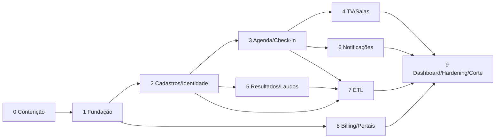

# 17 — Roadmap em fases

> Estimativas de esforço em faixas (equipe pequena, 1–2 devs sênior Laravel). Servem para ordenar e orçar, não como compromisso contratual. Estratégia de convivência: **strangler fig** — o novo sistema assume um módulo de cada vez, com o legado ainda no ar até o corte final.

## Fase 0 — Contenção de segurança no legado (antes de tudo)
**Esforço: P (dias).** Independe da reescrita e é urgente.
- Rotacionar as 3 senhas de banco; restringir grant por IP; tirar segredos do git e limpar histórico ([05](../analise/05-seguranca-lgpd-conformidade.md) C9).
- Remover do webroot: `info.php`, dumps `.sql`, `compactacao/`, `arquivos_zip/`, `prec.txt`, `teste_lw/Mail.php`.
- `exit;` após cada `header()` de bloqueio; confinar `manager.php`/`baixar_zip.php`/`excluir_pasta.php` ao diretório do usuário e exigir login.
- Varrer o host (links Monetizze no `info.php`).

## Fase 1 — Fundação da plataforma
[Confirmado] **Esforço: M.** PHP/Laravel e MySQL ou MariaDB conforme a [matriz de destino em 14 §14.1](14-arquitetura-laravel.md#141-stack--fonte-única-de-versões), multi-tenant (stancl atrás de contrato), ACL (spatie teams), auth (Fortify/Sanctum/2FA), schema central + tenant base, CI/CD, Sail/Docker e layout base Vuexy conforme a orientação do usuário. **Testes de isolamento de tenant desde já.**

## Fase 2 — Cadastros + identidade do paciente
**Esforço: M.** `patients` (identidade única, VOs Cpf/Telefone), `companies`/unidades, `users`/`professionals`, auditoria. Busca/merge assistido.

## Fase 3 — Agenda + Recepção/Check-in
**Esforço: M–G.** Agendamento (dia, com gancho p/ horário), confirmação, cancelamento, falta, reconvocação +1 ano; check-in com progresso por exame. Corrige a trava de duplicidade (B1).

## Fase 4 — Painel de TV + salas + roteiro (tempo real)
**Esforço: M.** Porta o `precordistv` (referência) para Reverb; `rooms`/`room_status` com FK (corrige B3), roteiro ligado ao atendimento (corrige B2), PIN com hash.

## Fase 5 — Resultados, laudos e anamnese
**Esforço: G.** `exam_results`/itens (recebe o `relatorio_prec`/Access), anamnese estruturada, laudo PDF, storage fora do webroot, link assinado. **Assinatura ICP-Brasil** pode ser subfase.

## Fase 6 — Notificações + pesquisa (fila)
**Esforço: M.** Canais e-mail/WhatsApp/SMS em fila (Horizon), campanhas, lembretes; internaliza/forma­liza o n8n; NPS+satisfação com vínculo correto (B5).

## Fase 7 — ETL do legado (Precordis = 1º tenant)
**Esforço: G.** Comandos Artisan idempotentes ([13](13-plano-migracao-dados.md)); depende das fases 2/3/5. Inclui descoberta do Access (pergunta #2). Rodar em staging, relatório de inconsistências, aprovação do negócio.

## Fase 8 — Billing + portais
**Esforço: M–G.** Assinatura (Asaas) + NFS-e + limites por plano; Portal do Paciente (MVP) e, depois, Portal da Empresa.

## Fase 9 — Dashboard/BI + hardening + corte
**Esforço: M.** Indicadores, revisão de segurança final, backups/retenção 20 anos testados, **corte** do legado.

## MVP sugerido (primeiro valor para a Precordis)
Fases 0 → 1 → 2 → 3 → 4 → 7 (parcial): a clínica passa a agendar, receber, chamar na TV e ver os pacientes migrados, no sistema novo, com segurança — mantendo laudo/Access por fora até a Fase 5. As fases 6/8/9 entregam notificação, cobrança e visão gerencial.
