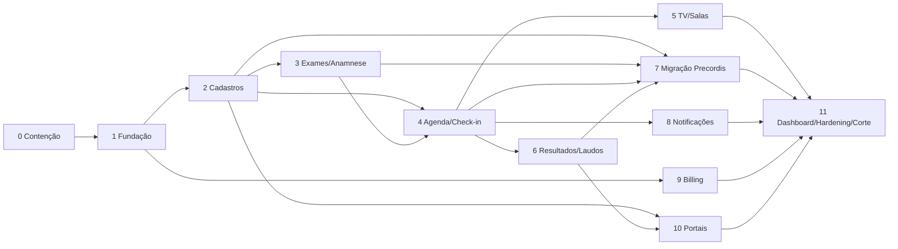

# 20 — Plano de desenvolvimento: fluxo, etapas e testes

> [Confirmado] Documento de execução do novo SaaS multi-tenant, com PHP/Laravel e MySQL ou MariaDB nas versões estáveis de destino da [matriz única em 14 §14.1](14-arquitetura-laravel.md#141-stack--fonte-única-de-versões). Complementa o roadmap de alto nível ([17](17-roadmap-fases.md)) com o **como construir**: ordem das etapas, entregáveis técnicos, testes e critérios de aceite de cada uma. A **migração da Precordis** é a Etapa 7.
>
> **Front-end (layout, CSS, JS, design system):** marcado como **[A DEFINIR]** onde aparece — será apontado posteriormente. As etapas que dependem de telas entregam primeiro o back-end + contratos de API/Inertia; a camada visual entra quando a direção de design chegar, sem bloquear o restante.

---

## 20.1 Fluxo de trabalho (vale para todas as etapas)

### Ciclo por etapa

```mermaid
flowchart LR
  A[Ler controle de fases + dependências] --> B[Branch feat/etapa-NN]
  B --> C[Migrations + Models + Enums/VOs]
  C --> D[Actions/Services + Policies + Form Requests]
  D --> E[Endpoints API /v1 + Resources]
  E --> F["Front-end [A DEFINIR] quando houver design"]
  F --> G[Testes: unit + feature + tenancy + arch]
  G --> H[CI verde: pint, rector, larastan, pest]
  H --> I[PR + revisão + squash merge]
  I --> J[Atualiza controle de fases]
```


### Regras
- **Uma etapa só começa** se todas as suas dependências estiverem `CONCLUÍDA`.
- **Branch** por etapa: `feat/etapa-NN-<slug>`; PR pequeno e revisado; merge por squash.
- **Nada entra sem CI verde**: `pint` (estilo) → `rector --dry-run` → `larastan` (nível máx viável) → `pest` (inclui testes de tenancy e arquitetura). Detalhe em [15](15-qualidade-testes-devops.md).
- **Definition of Done** (por etapa): código + testes dos tipos exigidos + migrations reversíveis + `tenants:migrate` roda limpo em 2 tenants + documentação curta no PR + controle de fases atualizado.
- **Segredos nunca no git** (lição do legado): `.env` + cofre; `.env.example` versionado.
- **Migrations seguras** (expand-contract) desde o início, porque rodam por tenant.
- **Idioma do domínio**: definir na Etapa 1 e manter (recomendação em [14](14-arquitetura-laravel.md) §14.7 → pergunta #20).

### Tipos de teste e quando cada um é obrigatório
| Tipo | Obrigatório em |
|---|---|
| Unit (VOs, regras puras) | toda etapa que cria regra/VO |
| Feature (HTTP/Inertia) | toda etapa com endpoint |
| **Tenancy (isolamento)** | Etapa 1 e **regressão em toda etapa** que cria tabela de tenant |
| Permissão por papel | toda etapa com ação protegida |
| Arch (Pest Arch) | contínuo (regras de fronteira) |

---

## 20.2 Quadro de etapas

| # | Etapa | Depende de | Entrega principal | Branch |
|---|---|---|---|---|
| 0 | Contenção de segurança no legado | — | legado seguro durante a convivência | `hotfix/legado-seguranca` |
| 1 | Fundação (tenancy, auth, ACL, CI/CD) | 0 | esqueleto multi-tenant + pipeline | `feat/etapa-01-fundacao` |
| 2 | Cadastros + identidade do paciente | 1 | paciente único, empresa, unidade, profissional | `feat/etapa-02-cadastros` |
| 3 | Catálogo de exames + anamnese | 2 | tipos de exame, preparos, ficha clínica | `feat/etapa-03-exames-anamnese` |
| 4 | Agenda + recepção/check-in | 2,3 | agendar, confirmar, faltar, check-in | `feat/etapa-04-agenda-checkin` |
| 5 | Painel de TV + salas + roteiro (tempo real) | 4 | chamada, salas com FK/PIN, roteiro | `feat/etapa-05-tv-salas` |
| 6 | Resultados, laudos e assinatura | 2,4 | resultado clínico, laudo PDF, ICP-Brasil | `feat/etapa-06-resultados-laudos` |
| 7 | **Migração da Precordis → tenant** | 2,3,4,6 | Precordis como 1º tenant com dados reais | `feat/etapa-07-migracao-precordis` |
| 8 | Notificações + pesquisa (fila) | 4 | e-mail/WhatsApp/SMS, NPS/satisfação | `feat/etapa-08-notificacoes` |
| 9 | Billing + assinatura | 1 | planos, cobrança recorrente, limites | `feat/etapa-09-billing` |
| 10 | Portais paciente/empresa | 2,6 | self-service + portal da empresa | `feat/etapa-10-portais` |
| 11 | Dashboard/BI + hardening + corte | todas | indicadores, revisão final, go-live | `feat/etapa-11-hardening` |



> **MVP** = Etapas 0 → 1 → 2 → 3 → 4 → 5 → 7. A clínica passa a agendar, receber, chamar na TV e ver os pacientes migrados, no sistema novo e seguro, mantendo laudo/Access por fora até a Etapa 6. As Etapas 8–11 agregam notificação, laudo assinado, cobrança, portais e visão gerencial.

---

## 20.3 Detalhamento das etapas

Cada etapa segue o mesmo gabarito: **Objetivo · Dependências · Entregáveis · Front-end · Testes · Critérios de aceite**.

### Etapa 0 — Contenção de segurança no legado
- **Objetivo:** fechar as falhas exploráveis hoje, já que o legado segue no ar durante a construção.
- **Entregáveis:** rotação das 3 senhas de banco + grant restrito por IP ([05](../analise/05-seguranca-lgpd-conformidade.md) C9); segredos fora do git (histórico limpo); remoção do webroot de `info.php`, dumps `.sql`, `compactacao/`, `arquivos_zip/`, `prec.txt`, `teste_lw/Mail.php`; `exit;` após cada `header()` de bloqueio; confinar `manager.php`/`baixar_zip.php`/`excluir_pasta.php` ao diretório do usuário e exigir login; varredura do host (links Monetizze no `info.php`).
- **Front-end:** n/a.
- **Testes:** checklist manual de verificação (cada item fechado confirmado em produção); smoke test de que o legado continua funcional.
- **Aceite:** nenhum endpoint de laudo acessível sem login; segredos ausentes do repositório; host varrido.

### Etapa 1 — Fundação
- **Objetivo:** esqueleto multi-tenant funcional com autenticação, ACL e pipeline — base de tudo.
- **Dependências:** 0.
- **Entregáveis:**
  - [Confirmado] Projeto PHP/Laravel conforme [14 §14.1](14-arquitetura-laravel.md#141-stack--fonte-única-de-versões); Sail/Herd; Docker; Redis; Horizon. Registrar as versões efetivas, validar dependências e selecionar MySQL ou MariaDB para central e tenants, com homologação no motor/versão de destino. O MariaDB 10.5 local não satisfaz essa matriz.
  - **Tenancy**: `stancl/tenancy` atrás de contratos próprios (`TenantResolver`, `TenantContext`); banco central + provisionamento de banco por tenant; identificação por subdomínio (+ header `X-Tenant` para API, + token de dispositivo para TV/totem). Comandos `tenant:create`, `tenants:migrate`.
  - **Auth**: Fortify + Sanctum; 2FA TOTP (obrigatório para papéis clínicos); política de senha; throttling; sessões ativas.
  - **ACL**: `spatie/laravel-permission` (teams=tenant); papéis padrão ([11](11-identidade-autenticacao-acl.md)); catálogo inicial de permissões; `AuditLog`.
  - Migrations centrais (`tenants`, `domains`, super-admin) + base do tenant (permission tables, `users`, `audit_log`).
  - **CI/CD** completo (pint/rector/larastan/pest), staging.
  - Estrutura de pastas modular ([14](14-arquitetura-laravel.md) §14.2); 1 Service Provider por módulo.
- **Front-end [A DEFINIR]:** esqueleto do back-office (Filament) e shell dos portais (Inertia) só com navegação mínima — tema/CSS/JS entram depois.
- **Testes:**
  - **Tenancy (bloqueante):** 2 tenants; request autenticado no tenant A nunca retorna dado do tenant B em query, cache, fila, storage e broadcast.
  - Auth: login, 2FA, throttle, reset.
  - ACL: papel sem permissão recebe 403.
  - Arch: controllers não acessam Models direto; domínio não importa HTTP; nenhum SDK fora de seu módulo.
- **Aceite:** criar tenant por comando provisiona banco e roda migrations; os testes de isolamento passam; CI verde.

### Etapa 2 — Cadastros + identidade do paciente
- **Objetivo:** identidade única do paciente (resolve o vínculo-por-nome do legado) + empresa, unidade, profissional.
- **Dependências:** 1.
- **Entregáveis:** Models `Patient`, `Company`/`CompanyUnit`, `Unit`, `Professional`; VOs `Cpf` (com validação de DV), `Telefone`, `Email`; migrations; Actions de CRUD + busca; `patient_company`; busca/autocomplete (Scout se necessário); **merge assistido** de pacientes (fila de revisão); auditoria de acesso a dado de paciente.
- **Front-end [A DEFINIR]:** telas de cadastro/busca/merge.
- **Testes:** unit dos VOs (CPF válido/inválido/duplicado); feature de CRUD; permissão (recepção vê só sua unidade; empresa vê só seus funcionários — Policy); tenancy (regressão).
- **Aceite:** cadastrar/buscar/fundir paciente; CPF único quando presente; auditoria registrando acesso.

### Etapa 3 — Catálogo de exames + anamnese
- **Objetivo:** tipos de exame com preparos/orientações e ficha clínica estruturada.
- **Dependências:** 2.
- **Entregáveis:** Models `ExamType`, `ExamTypePreparation`, `ExamTypeAttachment` (os PDFs de `orientacoes/`), `Anamnesis`, `AnamnesisAnswer`; perguntas versionadas por tipo de exame; consentimento LGPD versionado (texto + data); regra "campo obrigatório por empresa" como **configuração** (substitui o `if SAMARCO` hardcoded).
- **Front-end [A DEFINIR]:** formulário de anamnese (tablet) e catálogo.
- **Testes:** unit das regras de obrigatoriedade configurável; feature de preenchimento; consentimento gravado com versão/data; tenancy (regressão).
- **Aceite:** anamnese salva vinculada ao paciente; consentimento versionado; orientação anexada ao exame.

### Etapa 4 — Agenda + recepção/check-in
- **Objetivo:** agendar (por dia, com gancho para horário), confirmar, cancelar, faltar; check-in com progresso por exame.
- **Dependências:** 2, 3.
- **Entregáveis:** Models `Appointment` (+enum `AppointmentStatus` *backed*), `AppointmentExam`, `Checkin`, `CheckinExamStatus`; `AgendarExameAction`; derivação de status; **trava real de duplicidade** (corrige B1); reconvocação +1 ano; capacidade/regra de agenda por tenant ([14](14-arquitetura-laravel.md) §14.8); eventos `ExameAgendado`/`PacienteConfirmou`.
- **Front-end [A DEFINIR]:** calendário/agenda e painel de check-in.
- **Testes:** unit (derivação de status, trava de duplicidade que **de fato** bloqueia); feature dos fluxos agendar→confirmar→faltar→check-in; permissão por papel; tenancy (regressão).
- **Aceite:** não é possível duplicar agendamento ativo; status único e consistente; check-in reflete progresso.

### Etapa 5 — Painel de TV + salas + roteiro (tempo real)
- **Objetivo:** portar o `precordistv` (referência de qualidade) para tempo real e corrigir os bugs de sala/roteiro.
- **Dependências:** 4.
- **Entregáveis:** Models `Room` (PIN com **hash**), `RoomStatus` (**FK real** → corrige B3), `CallEvent`, `PatientRoute` (ligado ao atendimento → corrige B2); **Laravel Reverb** substituindo o polling; trava de concorrência de sala; liberação automática noturna como job agendado (não dentro do GET); acesso da TV/sala por token de dispositivo.
- **Front-end [A DEFINIR]:** tela da TV, tela de sala (celular), recepção.
- **Testes:** feature de chamar/ocupar/liberar; concorrência (paciente não em 2 salas; sala não com 2 pacientes); PIN por `hash_equals`; tempo real (evento publicado no canal do tenant); tenancy (canal do A não vaza para B).
- **Aceite:** chamada aparece na TV em tempo real; sem sala fantasma; roteiro persiste.

### Etapa 6 — Resultados, laudos e assinatura
- **Objetivo:** resultado clínico como entidade de 1ª classe (deixa de ser espelho do Access) + laudo com assinatura ICP-Brasil.
- **Dependências:** 2, 4.
- **Entregáveis:** Models `ExamResult`, `ExamResultItem` (indicadores tipados), `Laudo` (storage **fora do webroot**), `LaudoSignature`; enum `LaudoStatus`; geração de PDF; **assinatura ICP-Brasil** atrás de `LaudoSignerContract` (subfase); link assinado com expiração para o paciente; Policy "médico só assina o que executou"; `Framingham` como campo derivado.
- **Front-end [A DEFINIR]:** visualização/assinatura/liberação de laudo.
- **Testes:** feature de criar→assinar→liberar; Policy de autoria; link assinado expira; laudo do tenant A nunca resolve em path do tenant B; (assinatura ICP: teste de integração com certificado de homologação).
- **Aceite:** laudo liberado acessível só por link autorizado; assinatura verificável por QR; storage isolado por tenant.

### Etapa 7 — Migração da Precordis para o SaaS multi-tenant
- **Objetivo:** tornar a **Precordis o primeiro tenant**, com os dados reais dos 3 bancos MySQL + do Access importados e validados.
- **Dependências:** 2, 3, 4, 6 (precisa dos destinos: paciente, exame/anamnese, agenda, resultado/laudo).
- **Entregáveis:**
  - **Descoberta do Access** (pergunta #2): localizar, dimensionar, mapear a chave real do paciente e o histórico anterior a jun/2026.
  - Comandos **Artisan idempotentes** `legacy:import {etapa}` com tabela de-para `legacy_map` e relatório de inconsistências, na ordem de [13](13-plano-migracao-dados.md): empresas → pacientes (dedupe) → anamnese → agendamentos → check-in → resultados/laudos → pesquisa → arquivos (719 MB).
  - **Deduplicação** por confiança (CPF válido → nome+nascimento → revisão humana); criação de "paciente parcial" para os ~30% de agendamentos sem cadastro.
  - **Parser por linha** de datas e encoding; normalização de empresa/sexo.
  - Migração de senhas como "forçar redefinição no 1º acesso"; migração dos laudos para storage do tenant.
  - **Validação pós-migração**: contagens, somatórios, amostragem de 30 pacientes, relatório de inconsistências para o negócio.
- **Front-end [A DEFINIR]:** tela/relatório de conferência da migração (pode ser Filament).
- **Testes:**
  - Idempotência: rodar o import 2× não duplica.
  - Contagens batem com [01](../analise/01-inventario.md) §1.9 (tolerância documentada).
  - Dedupe: casos conhecidos (219 CPFs duplicados, 49 logins duplicados, 14 duplicatas nome+data) resolvidos conforme regra.
  - Datas/encoding: amostra validada.
  - Integridade: nenhum laudo órfão; cada PDF vinculado a um paciente.
- **Aceite:** Precordis operando como tenant em staging com dados reais; relatório de inconsistências **aprovado pelo negócio**; nenhuma regressão nos testes de tenancy.

### Etapa 8 — Notificações + pesquisa (fila)
- **Objetivo:** mensageria em fila (substitui o `send-mail` morto e formaliza o n8n) + NPS/satisfação com vínculo correto.
- **Dependências:** 4.
- **Entregáveis:** `NotificationChannel` (contratos) com canais Email/WhatsApp/SMS; `NotificationTemplate`, `Notification` (fila via Horizon); campanhas (convocação, reconvocação, fim de ano); `Survey` com `appointment_id` (corrige B5); operador (WhatsApp) formalizado por contrato.
- **Front-end [A DEFINIR]:** gestão de templates/campanhas e relatório de NPS.
- **Testes:** feature de enfileirar/enviar/falhar com idempotência; webhook de retorno; NPS e satisfação ligados ao atendimento; tenancy (fila roda na conexão do tenant certo).
- **Aceite:** notificação enfileirada e processada por tenant; pesquisa cruzável por atendimento.

### Etapa 9 — Billing + assinatura
- **Objetivo:** cobrança recorrente da clínica e limites por plano.
- **Dependências:** 1.
- **Entregáveis:** `BillingGatewayContract` + `AsaasGateway` (PIX/boleto/cartão + NFS-e); Models `Plan`/`PlanFeature`/`Subscription`/`Invoice`/`Payment`/`UsageRecord`/`Coupon`/`WebhookEvent` (banco central); webhooks idempotentes; estados `active→past_due→read_only→suspended` por middleware; feature flags por plano.
- **Front-end [A DEFINIR]:** área de assinatura/plano do tenant e painel do super-admin.
- **Testes:** feature de assinar/trocar plano (pró-rata)/cancelar; webhook idempotente; bloqueio progressivo por inadimplência não apaga dados; limites de plano aplicados por middleware.
- **Aceite:** assinatura criada e cobrada em sandbox; limites refletidos no acesso; NFS-e emitida.

### Etapa 10 — Portais paciente/empresa
- **Objetivo:** self-service do paciente e portal da empresa cliente.
- **Dependências:** 2, 6.
- **Entregáveis:** Portal do Paciente (agendar, preparo, baixar laudo por link assinado, responder pesquisa); Portal da Empresa (exames dos funcionários, ASO, relatórios) com Policy de escopo por empresa.
- **Front-end [A DEFINIR]:** este é o front mais sensível ao design premium — entra quando a direção visual chegar.
- **Testes:** permissão (paciente só vê o seu; empresa só seus funcionários); link de laudo expira; feature dos fluxos; tenancy.
- **Aceite:** paciente baixa o próprio laudo com segurança; empresa vê só seus funcionários.

### Etapa 11 — Dashboard/BI + hardening + corte
- **Objetivo:** visão gerencial, revisão final de segurança e go-live.
- **Dependências:** todas.
- **Entregáveis:** indicadores (exames/dia, ocupação, no-show, tempo por sala, NPS, reconvocar); revisão OWASP/LGPD; backups + retenção ≥ 20 anos **com restore testado por tenant**; monitoramento (incl. do sync do Access enquanto existir); **plano de corte** (strangler) — ver [18](18-riscos-migracao.md) §18.3.
- **Front-end [A DEFINIR]:** dashboards.
- **Testes:** feature dos relatórios; teste de restore por tenant; revisão de segurança (checklist); ensaio de corte em staging.
- **Aceite:** go/no-go objetivo (relatório de migração aprovado, contagens ok, amostra conferida, testes de isolamento verdes, restore testado).

---

## 20.4 Controle de fases (manter atualizado)

> Fonte da verdade do andamento. Atualizar ao fim de cada sessão. `PENDENTE · EM_ANDAMENTO · BLOQUEADA · CONCLUÍDA · REABERTA`.

| # | Etapa | Depende de | Status | Branch | Concluída em | Observações |
|---|---|---|---|---|---|---|
| 0 | Contenção legado | — | PENDENTE | `hotfix/legado-seguranca` | — | urgente, independe da reescrita |
| 1 | Fundação | 0 | PENDENTE | `feat/etapa-01-fundacao` | — | |
| 2 | Cadastros/identidade | 1 | PENDENTE | `feat/etapa-02-cadastros` | — | |
| 3 | Exames/anamnese | 2 | PENDENTE | `feat/etapa-03-exames-anamnese` | — | |
| 4 | Agenda/check-in | 2,3 | PENDENTE | `feat/etapa-04-agenda-checkin` | — | |
| 5 | TV/salas (tempo real) | 4 | PENDENTE | `feat/etapa-05-tv-salas` | — | |
| 6 | Resultados/laudos | 2,4 | PENDENTE | `feat/etapa-06-resultados-laudos` | — | assinatura ICP = subfase |
| 7 | **Migração Precordis** | 2,3,4,6 | PENDENTE | `feat/etapa-07-migracao-precordis` | — | depende da descoberta do Access |
| 8 | Notificações/pesquisa | 4 | PENDENTE | `feat/etapa-08-notificacoes` | — | |
| 9 | Billing | 1 | PENDENTE | `feat/etapa-09-billing` | — | |
| 10 | Portais | 2,6 | PENDENTE | `feat/etapa-10-portais` | — | front premium [A DEFINIR] |
| 11 | Dashboard/hardening/corte | todas | PENDENTE | `feat/etapa-11-hardening` | — | go-live |

## 20.5 Registro de execução (uma entrada por sessão — não apagar)

```
## [AAAA-MM-DD HH:MM] Etapa NN — <nome>
Status ao final: CONCLUÍDA | EM_ANDAMENTO | BLOQUEADA
Branch / commits:
Entregue:
Não entregue / adiado (e por quê):
Decisões (sobretudo onde o escopo deixava margem):
Testes adicionados:
Pendências / próximos passos:
```

## 20.6 Pendências que destravam o desenvolvimento
Antes/durante as primeiras etapas, resolver de [19](19-perguntas-em-aberto-negocio.md): **#2 (Access)**, **#3 (produção real)**, **#8/#9 (agenda por dia vs horário, capacidade)**, **#14 (regras por empresa)**, **#18 (gateway/plano)**, **#20 (idioma do código)**, **#21 (janela de corte)**. O front-end (layout/CSS/JS/design system) será apontado posteriormente e não bloqueia o back-end das etapas.
